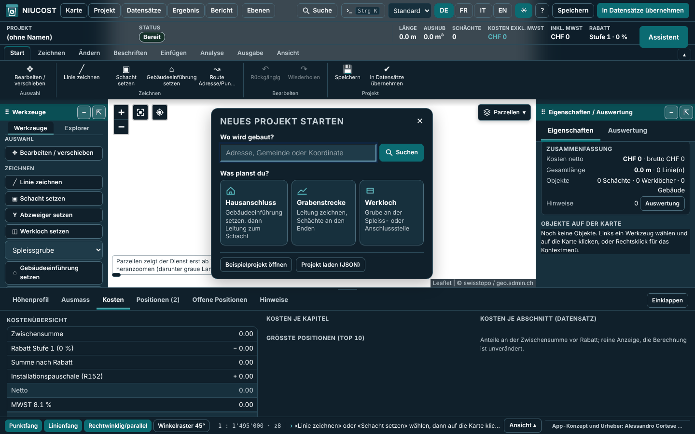

# UX-Runde 11/2026 – NIUcost (LV-Devis Tiefbau)

App-Konzept und Urheber: **Alessandro Cortese**. Grundlage: Durchsicht Stand V145 (Build 20.11.2026), Desktop 1440 px und Handy 390 px.
Reine Oberflächenänderungen – Rechenkern (`src/kve.js`, `src/model.js`, `skill/.../kve.py`) unverändert. Bilder: `docs/ux-runde/` (pNN-vorher/nachher-1440/390).

## P1 – Startzustand statt leerer Karte

**Für die Benutzer:** Ein leeres Projekt öffnet nicht mehr auf der fast leeren Schweizkarte, sondern mit einer Startkarte in der Kartenmitte:
- Suche «Adresse, Gemeinde oder Koordinate» (gleicher geo.admin-Suchdienst wie die Kopfsuche, zusätzlich LV95- und WGS84-Koordinaten wie `2'759'000 / 1'191'000`); Treffer → Zoomstufe ≥ 17.
- Vorlagen «Hausanschluss» (Gebäudeeinführung setzen), «Grabenstrecke» (Linie zeichnen), «Werkloch» (Werkloch setzen) – sie aktivieren nur das Werkzeug und zeigen einen kurzen Hinweis, es entstehen keine Mengen.
- «Beispielprojekt öffnen» und «Projekt laden (JSON)».
- Startort: Ort aus den Projektangaben (Zoom 16), sonst der zuletzt benutzte Kartenausschnitt (UI-Einstellung `lvd-km-view`, nicht im Projekt).
- Die Startkarte verschwindet beim ersten Objekt oder wenn ein Werkzeug gewählt wird; Esc oder «×» blenden sie aus.
- Parzellen-Hinweis «erst ab Zoomstufe 15»: mit «×», schliesst nach 6 s, erscheint pro Sitzung nur einmal.

| | Desktop 1440 px | Handy 390 px |
|---|---|---|
| vorher |  |  |
| nachher |  |  |

Test: `t134` (neu). Testhilfe: ältere Tests starten ohne Startkarte (`window.__LVD_START_OFF`, wie die minimierte Multifunktionsleiste); `t101`/`t110` an die neuen Regeln angepasst (Hinweis einmal pro Sitzung, Start am letzten Ausschnitt).
