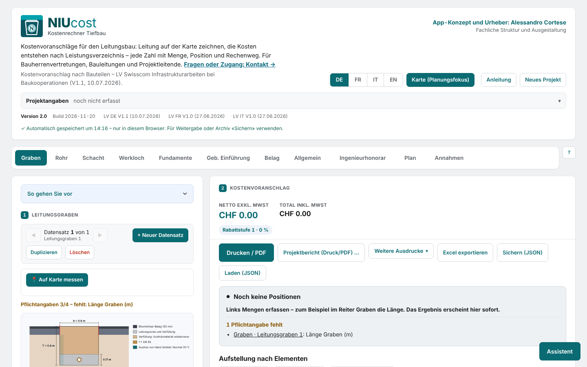
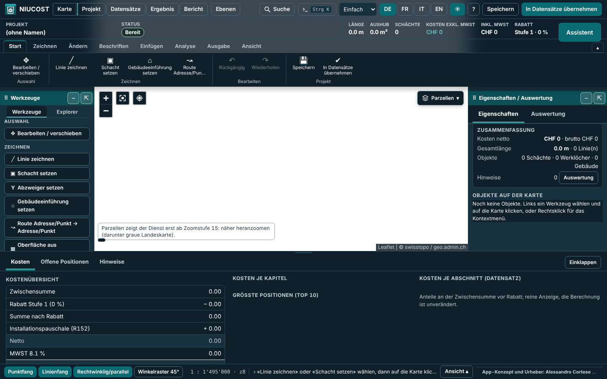
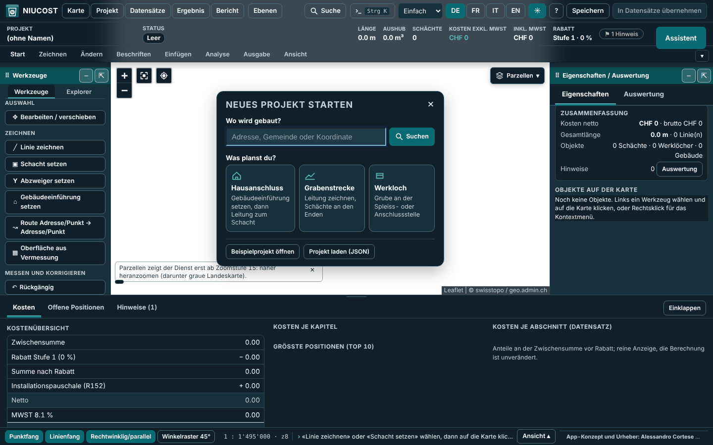

# UX-Runde 11/2026 – NIUcost (LV-Devis Tiefbau)

App-Konzept und Urheber: **Alessandro Cortese**. Grundlage: Durchsicht Stand V145 (Build 20.11.2026), Desktop 1440 px und Handy 390 px.
Reine Oberflächenänderungen – Rechenkern (`src/kve.js`, `src/model.js`, `skill/.../kve.py`) unverändert. Bilder: `docs/ux-runde/` (pNN-vorher/nachher-1440/390).

## P1 – Startzustand statt leerer Karte

**Für die Benutzer:** Ein leeres Projekt öffnet nicht mehr auf der fast leeren Schweizkarte, sondern mit einer Startkarte in der Kartenmitte:
- Suche «Adresse, Gemeinde oder Koordinate» (gleicher geo.admin-Suchdienst wie die Kopfsuche, zusätzlich LV95- und WGS84-Koordinaten wie `2'759'000 / 1'191'000`); Treffer → Zoomstufe ≥ 17.
- Vorlagen «Hausanschluss» (Gebäudeeinführung setzen), «Grabenstrecke» (Linie zeichnen), «Werkloch» (Werkloch setzen) – sie aktivieren nur das Werkzeug und zeigen einen kurzen Hinweis, es entstehen keine Mengen.
- «Beispielprojekt öffnen» und «Projekt laden (JSON)».
- Startort: Ort aus den Projektangaben (Zoom 16), sonst der zuletzt benutzte Kartenausschnitt (UI-Einstellung `lvd-km-view`, nicht im Projekt).
- Die Startkarte verschwindet beim ersten Objekt oder wenn ein Werkzeug gewählt wird; Esc oder «×» blenden sie aus.
- Parzellen-Hinweis «erst ab Zoomstufe 15»: mit «×», schliesst nach 6 s, erscheint pro Sitzung nur einmal.

| | Desktop 1440 px | Handy 390 px |
|---|---|---|
| vorher |  |  |
| nachher |  |  |

Test: `t134` (neu). Testhilfe: ältere Tests starten ohne Startkarte (`window.__LVD_START_OFF`, wie die minimierte Multifunktionsleiste); `t101`/`t110` an die neuen Regeln angepasst (Hinweis einmal pro Sitzung, Start am letzten Ausschnitt).

## P2 – «Keine Warnungen», obwohl Pflichtangaben fehlen

**Für die Benutzer:** Fehlende Pflichtangaben sind jetzt eine eigene Kategorie im Hinweisfeld («1 Pflichtangabe fehlt» / «n Pflichtangaben fehlen») mit Liste «Reiter · Datensatz: Feld». Ein Klick springt direkt zum Feld. Berücksichtigt werden Datensätze mit Positionen, von Hand geänderte und der gerade bearbeitete Datensatz.
- Ein leeres Projekt (keine Positionen, Zwischensumme 0) zeigt einen neutralen Status «Noch keine Positionen», nie mehr grün.
- Grün («Keine Warnungen») erscheint nur, wenn Positionen vorhanden und alle Pflichtangaben vollständig sind; sonst «Hinweise beachten».
- Layout A, Status im Kopf: «Leer», «Unvollständig (n)» (n = fehlende Pflichtangaben + kritische Punkte) oder «Bereit». Der Reiter «Hinweise» listet die fehlenden Angaben zuoberst; ein Klick führt zum Feld. Kennzahl «1 Hinweis» in der Einzahl.

| | Desktop 1440 px | Handy 390 px |
|---|---|---|
| vorher klassisch |  |  |
| nachher klassisch |  |  |
| vorher Layout A |  |  |
| nachher Layout A |  |  |

Test: `t135` (neu).

## P3 – Befehle ohne Dubletten, Hauptknopf nur wenn sinnvoll

**Für die Benutzer:**
- «In Datensätze übernehmen» ist inaktiv, solange nichts Neues zu übernehmen ist (Tooltip «Zuerst Leitung oder Objekt zeichnen»). Bei Änderungen zeigt der Knopf einen Zähler, z. B. «In Datensätze übernehmen (3)». Gezählt werden neue, geänderte und gelöschte Objekte seit dem Öffnen sowie Objekte, die noch mit keinem Datensatz verknüpft sind (z. B. nur gesicherte Zeichnung). Auch der Schalter «Schräglänge» und Änderungen am Plan-Overlay gelten als Änderung. «Rückgängig» zählt mit.
- «Speichern» und «In Datensätze übernehmen» stehen nur noch im Kopf (nicht mehr zusätzlich in der Multifunktionsleiste).
- Modus «Einfach»: Multifunktionsleiste standardmässig minimiert, gesteuert wird über die Werkzeugspalte – jeder Zeichenbefehl ist genau einmal sichtbar. Modus «Experte»: Leiste wie bisher.

| | Desktop 1440 px (Modus Einfach) | Handy 390 px |
|---|---|---|
| vorher |  |  |
| nachher |  |  |

Test: `t136` (neu). Angepasst: `t90` (Leiste ohne Gruppe «Projekt»), `t42` (schliesst mit «Schliessen» statt «Übernehmen» ohne Änderung), `t110` (Start am letzten Ausschnitt).
