# UX-Runde 11/2026 – NIUcost (LV-Devis Tiefbau)

App-Konzept und Urheber: **Alessandro Cortese**. Grundlage: Durchsicht Stand V145 (Build 20.11.2026), Desktop 1440 px und Handy 390 px.
Reine Oberflächenänderungen – Rechenkern (`src/kve.js`, `src/model.js`, `skill/.../kve.py`) unverändert. Bilder: `docs/ux-runde/` (pNN-vorher/nachher-1440/390).

## P1 – Startzustand statt leerer Karte

**Für die Benutzer:** Ein leeres Projekt öffnet nicht mehr auf der fast leeren Schweizkarte, sondern mit einer Startkarte in der Kartenmitte:
- Suche «Adresse, Gemeinde oder Koordinate» (gleicher geo.admin-Suchdienst wie die Kopfsuche, zusätzlich LV95- und WGS84-Koordinaten wie `2'759'000 / 1'191'000`); Treffer → Zoomstufe ≥ 17.
- Vorlagen «Hausanschluss» (Gebäudeeinführung setzen), «Grabenstrecke» (Linie zeichnen), «Werkloch» (Werkloch setzen) – sie aktivieren nur das Werkzeug und zeigen einen kurzen Hinweis, es entstehen keine Mengen.
- «Beispielprojekt öffnen» und «Projekt laden (JSON)».
- Startort: Ort aus den Projektangaben (Zoom 16), sonst der zuletzt benutzte Kartenausschnitt (UI-Einstellung `lvd-km-view`, nicht im Projekt).
- Die Startkarte verschwindet beim ersten Objekt oder wenn ein Werkzeug gewählt wird; Esc oder «×» blenden sie aus.
- Parzellen-Hinweis «erst ab Zoomstufe 15»: mit «×», schliesst nach 6 s, erscheint pro Sitzung nur einmal.

| | Desktop 1440 px | Handy 390 px |
|---|---|---|
| vorher |  |  |
| nachher |  | 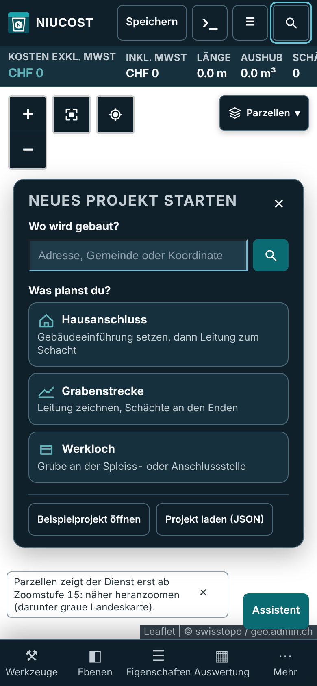 |

Test: `t134` (neu). Testhilfe: ältere Tests starten ohne Startkarte (`window.__LVD_START_OFF`, wie die minimierte Multifunktionsleiste); `t101`/`t110` an die neuen Regeln angepasst (Hinweis einmal pro Sitzung, Start am letzten Ausschnitt).

## P2 – «Keine Warnungen», obwohl Pflichtangaben fehlen

**Für die Benutzer:** Fehlende Pflichtangaben sind jetzt eine eigene Kategorie im Hinweisfeld («1 Pflichtangabe fehlt» / «n Pflichtangaben fehlen») mit Liste «Reiter · Datensatz: Feld». Ein Klick springt direkt zum Feld. Berücksichtigt werden Datensätze mit Positionen, von Hand geänderte und der gerade bearbeitete Datensatz.
- Ein leeres Projekt (keine Positionen, Zwischensumme 0) zeigt einen neutralen Status «Noch keine Positionen», nie mehr grün.
- Grün («Keine Warnungen») erscheint nur, wenn Positionen vorhanden und alle Pflichtangaben vollständig sind; sonst «Hinweise beachten».
- Layout A, Status im Kopf: «Leer», «Unvollständig (n)» (n = fehlende Pflichtangaben + kritische Punkte) oder «Bereit». Der Reiter «Hinweise» listet die fehlenden Angaben zuoberst; ein Klick führt zum Feld. Kennzahl «1 Hinweis» in der Einzahl.

| | Desktop 1440 px | Handy 390 px |
|---|---|---|
| vorher klassisch | 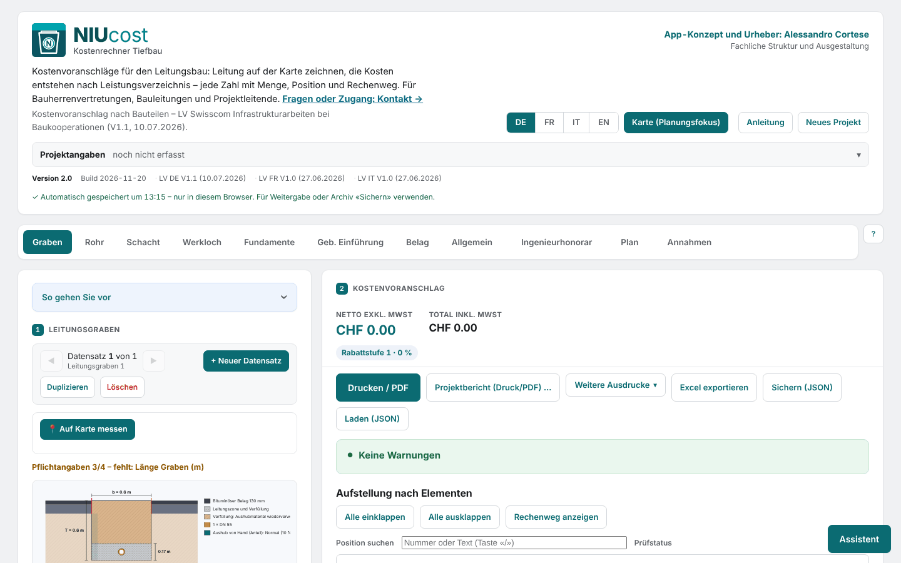 |  |
| nachher klassisch |  |  |
| vorher Layout A |  |  |
| nachher Layout A |  | 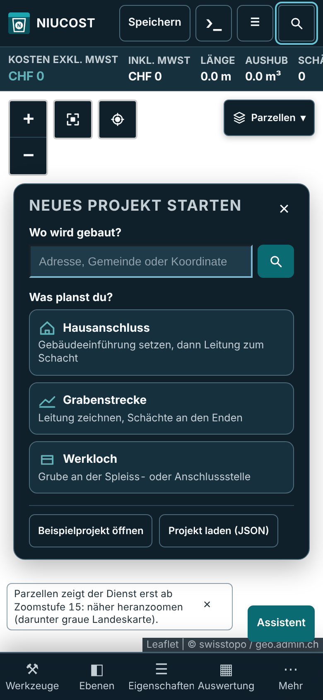 |

Test: `t135` (neu).

## P3 – Befehle ohne Dubletten, Hauptknopf nur wenn sinnvoll

**Für die Benutzer:**
- «In Datensätze übernehmen» ist inaktiv, solange nichts Neues zu übernehmen ist (Tooltip «Zuerst Leitung oder Objekt zeichnen»). Bei Änderungen zeigt der Knopf einen Zähler, z. B. «In Datensätze übernehmen (3)». Gezählt werden neue, geänderte und gelöschte Objekte seit dem Öffnen sowie Objekte, die noch mit keinem Datensatz verknüpft sind (z. B. nur gesicherte Zeichnung). Auch der Schalter «Schräglänge» und Änderungen am Plan-Overlay gelten als Änderung. «Rückgängig» zählt mit.
- «Speichern» und «In Datensätze übernehmen» stehen nur noch im Kopf (nicht mehr zusätzlich in der Multifunktionsleiste).
- Modus «Einfach»: Multifunktionsleiste standardmässig minimiert, gesteuert wird über die Werkzeugspalte – jeder Zeichenbefehl ist genau einmal sichtbar. Modus «Experte»: Leiste wie bisher.

| | Desktop 1440 px (Modus Einfach) | Handy 390 px |
|---|---|---|
| vorher |  | 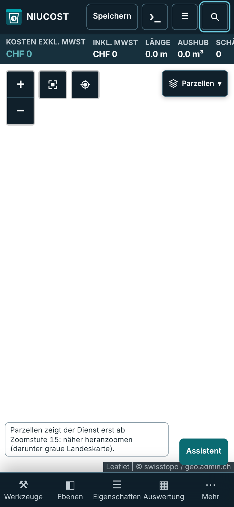 |
| nachher |  |  |

Test: `t136` (neu). Angepasst: `t90` (Leiste ohne Gruppe «Projekt»), `t42` (schliesst mit «Schliessen» statt «Übernehmen» ohne Änderung), `t110` (Start am letzten Ausschnitt).

## P4 – Kosten-Unterschied nach «Übernehmen»

**Für die Benutzer:** Nach «In Datensätze übernehmen» erscheint eine Meldung mit dem Unterschied, z. B. «+ CHF 8'692.50 netto (Schacht 1)», gefolgt von der bisherigen Übernahme-Zusammenfassung und dem Knopf «Rückgängig». Netto vorher/nachher stammen aus dem Rechenkern (exkl. MWST), es wird nichts neu gerechnet; die Objekte kommen aus der Änderungsliste von P3 (höchstens 4 Namen, dann «…»).
- Layout A: Die Meldung erscheint jetzt in der wieder geöffneten Karte (vorher lag sie verdeckt hinter dem Vollbild). Die Kennzahl «Kosten exkl. MWST» blendet den Unterschied 2 s lang ein («+ CHF 8'693»). «Rückgängig» stellt den Stand vor dem Übernehmen her und öffnet die Karte neu.
- Klassische Ansicht und Plan: gleiche Meldung mit Unterschied.
- Status «Unvollständig (n)» wird im Kopf nicht mehr abgeschnitten.

| | Desktop 1440 px | Handy 390 px |
|---|---|---|
| vorher | 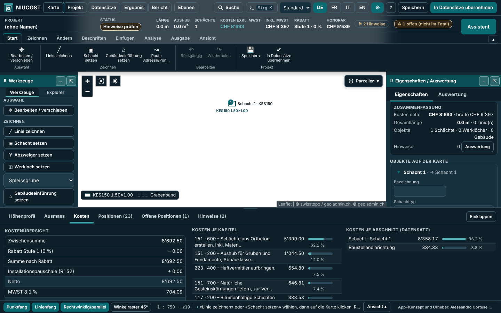 | 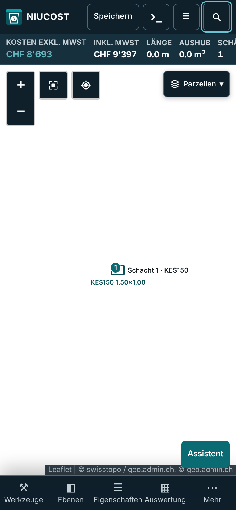 |
| nachher | 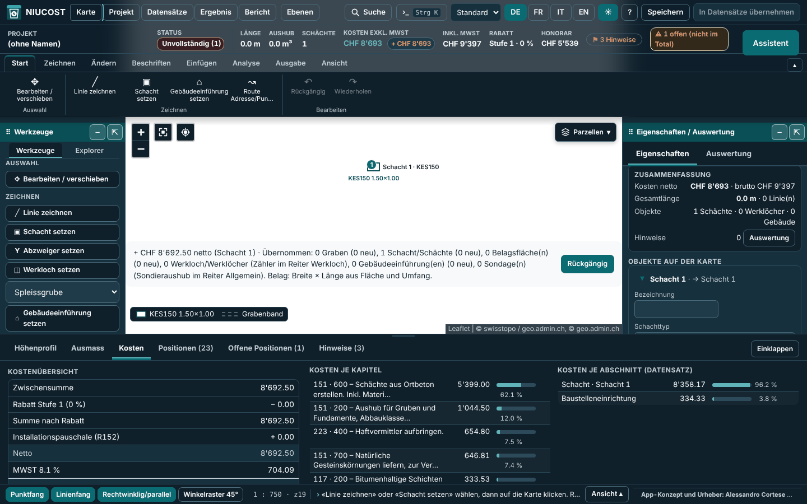 | 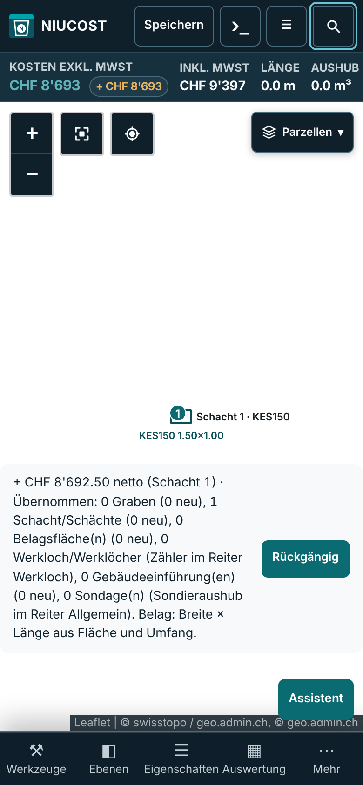 |

Test: `t137` (neu): Unterschied = Netto nachher − Netto vorher auf den Rappen (Hinzufügen und Löschen), Kennzahl 2 s, Rückgängig, klassische Ansicht.

## P5 – Ein Erscheinungsbild statt zwei Welten

**Für die Benutzer:**
- **«Projekt» in Layout A** öffnet die Projektangaben als Seitenpanel rechts. Es wechselt nicht mehr in die klassische Ansicht. Es sind dieselben Felder wie auf der Seite (gleiche Speicherung), die Projektleiste (Projekt, Ort) folgt live. «Fertig», «×», Esc oder «Karte» schliessen das Panel. Karte → Projekt → Karte geht ohne Layoutwechsel. Die klassische Ansicht bleibt über den Layout-Umschalter erreichbar. «Datensätze», «Ergebnis» und «Bericht» funktionieren wie bisher.
- **Hell/Dunkel ist ein globales Thema** (Knopf ☀︎/☾ im Arbeitsplatz und neu auf der klassischen Seite). Die Wahl (UI-Einstellung `lvd-theme`, Vorgabe dunkel wie bisher im Arbeitsplatz) gilt für Layout A, die klassische Seite, das Kartenfenster und den Plan gleich. Der Druck (Bericht, PDF) bleibt immer hell.
- Umsetzung über die Tokens in `src/tokens.css` (`html.nc-dark`). Die dunklen Gegenstücke der klassischen Seite erzeugt `tools/make_dark.py` → `src/theme_dark.css` aus den bestehenden hellen Regeln (helle Flächen → Flächen-Tokens, dunkle Schrift → Text-Tokens). Akzent-, Status- und Signalflächen sind von Hand gesetzt. axe: keine Kontrastfehler im dunklen Thema (klassisch, Kartenfenster, Assistent, Anleitung, Prüfstatus).

| | Desktop 1440 px | Handy 390 px |
|---|---|---|
| vorher (Projekt → klassische Seite) | 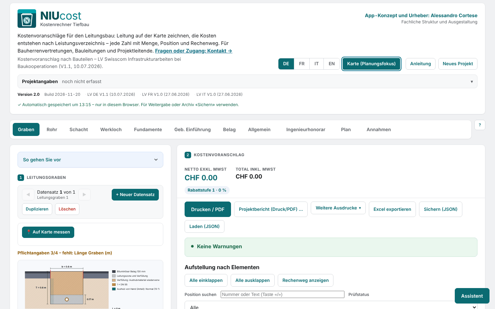 | 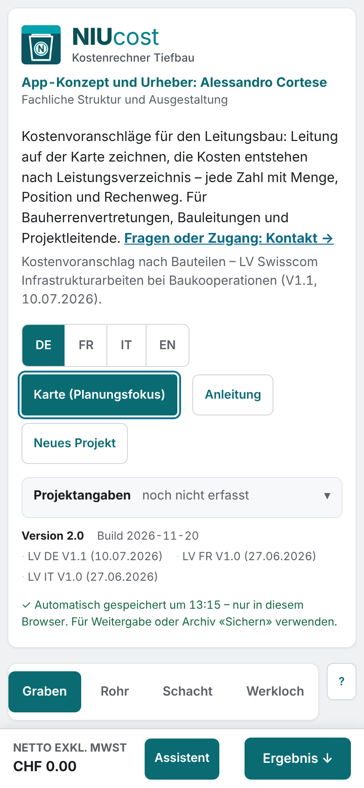 |
| nachher (Projekt als Seitenpanel) | 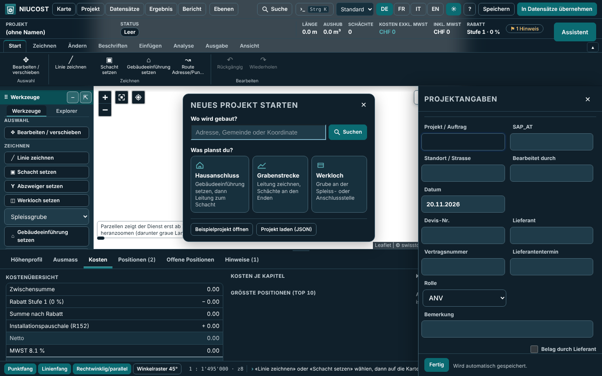 | 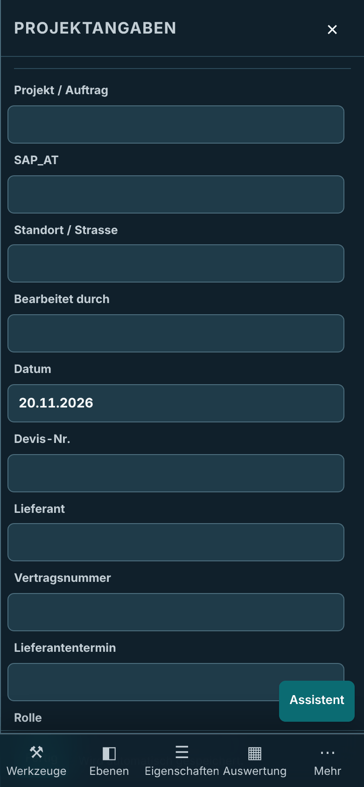 |
| nachher klassisch, dunkles Thema | 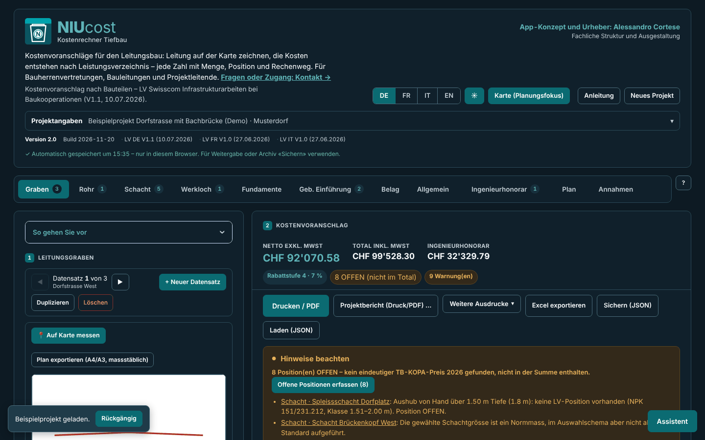 | 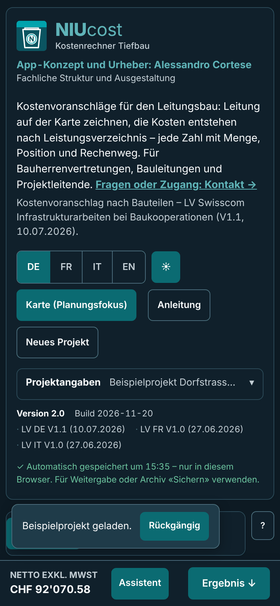 |

Test: `t138` (neu). Angepasst: `t65`/`t72` (Rückfrage beim Wechsel jetzt über «Datensätze», weil «Projekt» die Karte nicht mehr verlässt), `t79`/`t90` (Themenknopf im Arbeitsplatz eindeutig ansprechen).

## P6 – Leere Zustände statt Nulltabellen

**Für die Benutzer:**
- Layout A, Reiter «Kosten» ohne Positionen: statt einer Tabelle mit 0.00 der Hinweis «Noch keine Kosten – zeichne eine Leitung oder setze einen Schacht.» mit dem Knopf «Werkzeuge zeigen» (führt zu «Linie zeichnen» in der Werkzeugspalte, am Handy öffnet sich das Werkzeugblatt). Bewusst kein zweiter Zeichenbefehl, damit P3 «jeder Befehl genau einmal» gilt (in P7 nachgeschärft).
- Klassische Ansicht ohne Positionen: nur der Status mit Hinweis, keine Kostentabelle und keine leere «Aufstellung».
- Kostentabelle: Bei Rabattstufe 1 werden «Rabatt Stufe 1 (0 %)» und «Summe nach Rabatt» ausgeblendet, eine Installationspauschale von 0 ebenfalls. Ab Stufe 2 oder bei einem Betrag erscheinen sie wie bisher. Netto und Total bleiben identisch.
- Leere Unterbereiche («Kosten je Kapitel», «Grösste Positionen», «Kosten je Abschnitt») werden ausgeblendet.
- Nebenbei korrigiert: Der Knopf zur Kartenauswahl («Parzellen ▾») war nach P5 blass; er hat wieder das Gewicht wie vorher.

| | Desktop 1440 px | Handy 390 px |
|---|---|---|
| vorher | 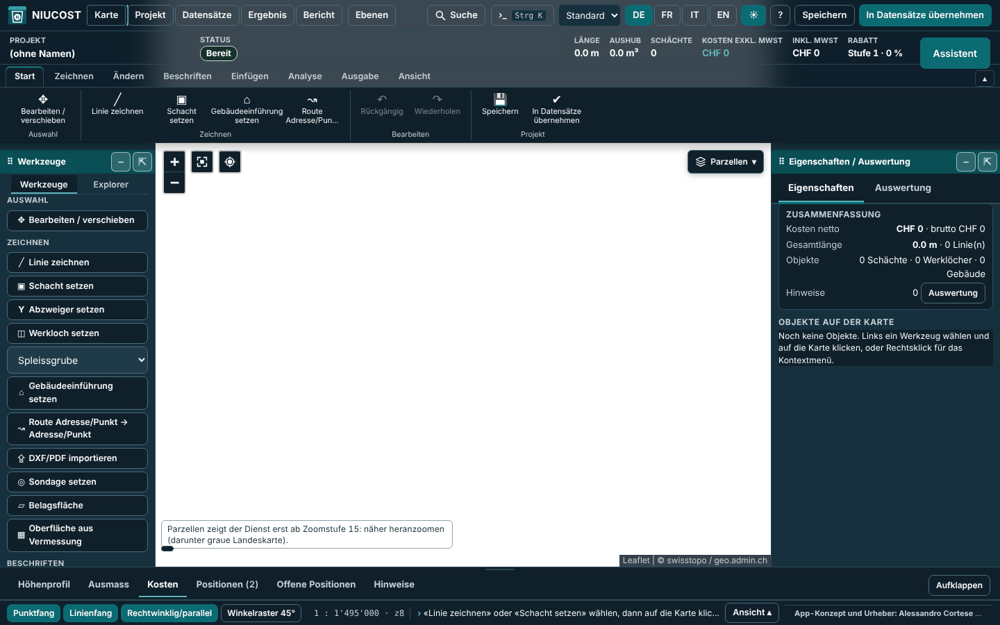 | 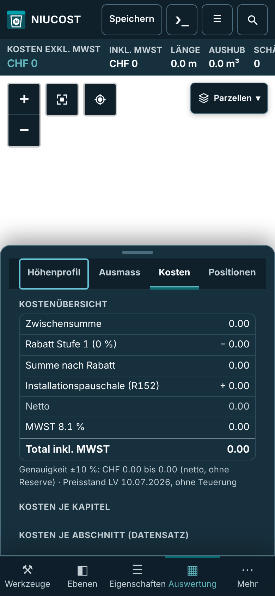 |
| nachher | 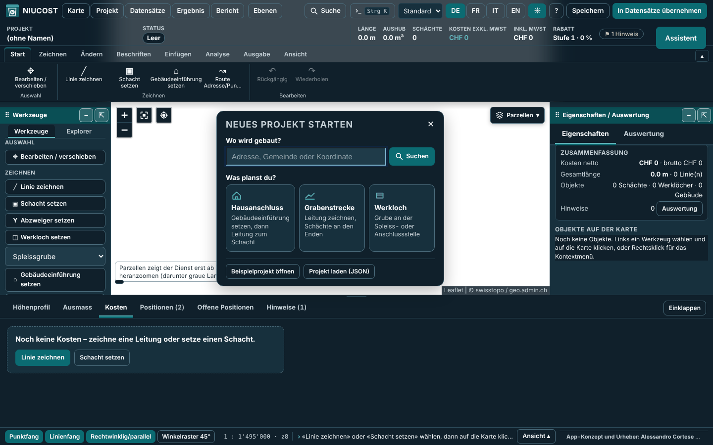 | 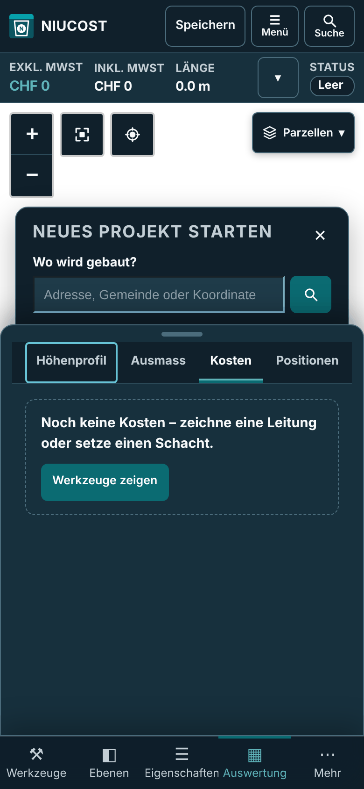 |

Test: `t139` (neu).

## P7 – Handy (≤ 860 px)

**Für die Benutzer:**
- **Kennzahlenleiste:** am Handy höchstens 3 Kennzahlen (Exkl. MWST, Inkl. MWST, Länge) mit kurzen Beschriftungen, nichts mehr abgeschnitten. Ein Tipp auf die Leiste oder auf ▾ zeigt alle Kennzahlen, ein weiterer Tipp klappt sie wieder zu.
- **Kopf:** «Menü» und «Suche» tragen eine sichtbare Mini-Beschriftung. Die Befehlsleiste (›_) ist vom Kopf ins Blatt «Mehr» gewandert («Befehle suchen»).
- **Blatt «Mehr»:** Fangoptionen gruppiert unter «Fang- und Zeichenhilfen», mit je einer Erklärzeile (auch für Screenreader verknüpft). Die Urheberzeile steht ganz unten.
- **Keine Überdeckungen:** Kartenhinweise lassen rechts Platz für den Assistent-Knopf. Die Startkarte (P1) steht unter den Kartenknöpfen, der Parzellen-Hinweis wartet, solange sie offen ist. Ein schmaler Rand eines falsch umgebrochenen Elements im Blatt «Mehr» ist behoben.
- **Desktop-Statuszeile:** Der volle Text steht als Tooltip zur Verfügung, wenn die Zeile abgeschnitten ist. Er folgt dem gewählten Werkzeug.
- Nachgeschärft (P6): Der leere Kostenreiter führt mit «Werkzeuge zeigen» zur Werkzeugspalte statt eigene Zeichenknöpfe zu zeigen, damit jeder Befehl nur einmal vorkommt.

| | Desktop 1440 px | Handy 390 px |
|---|---|---|
| vorher | 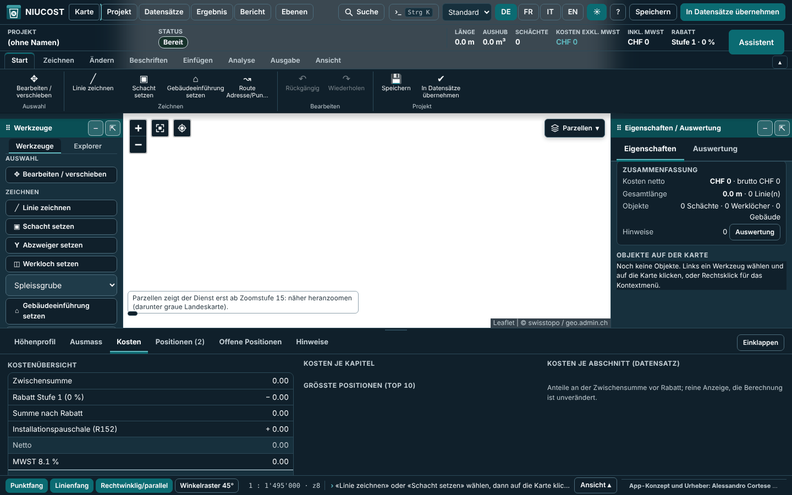 | 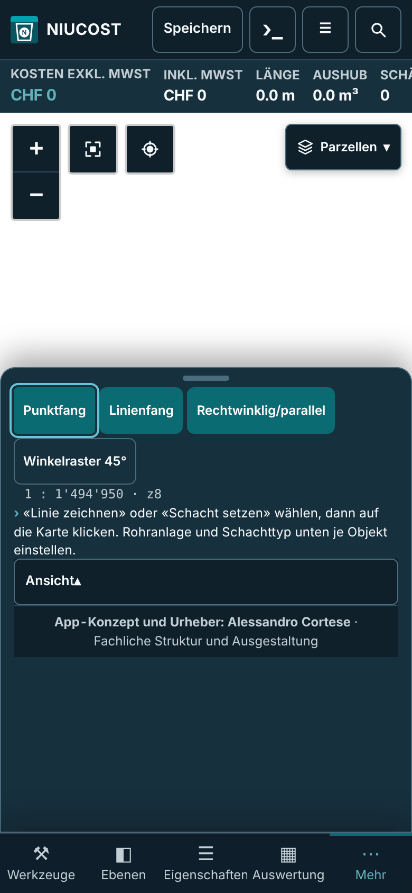 |
| nachher | 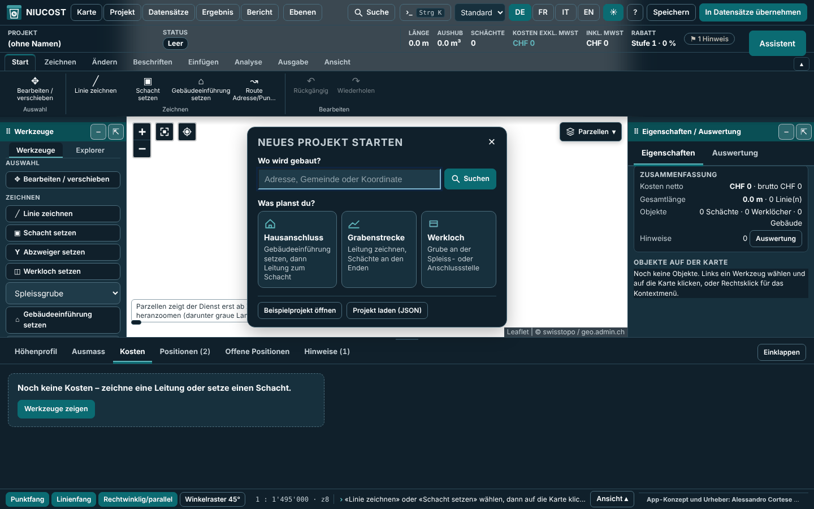 | 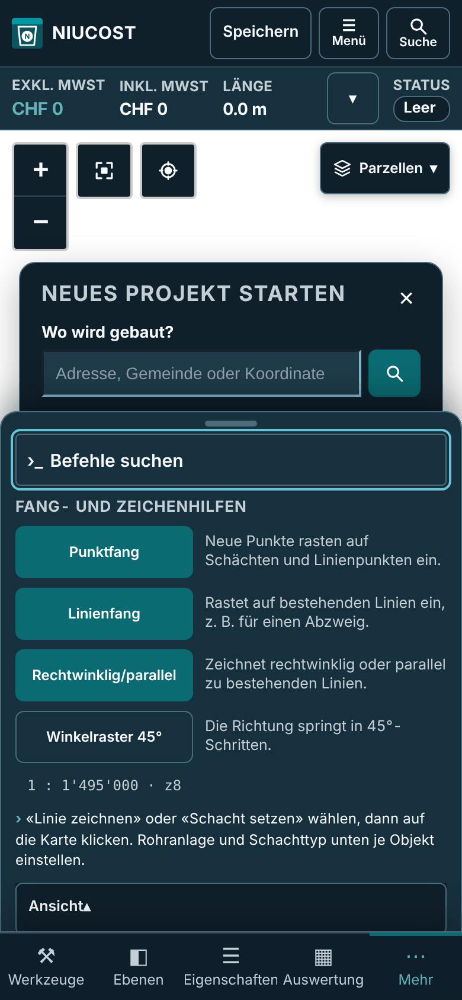 |
| nachher, «Mehr» gescrollt | | 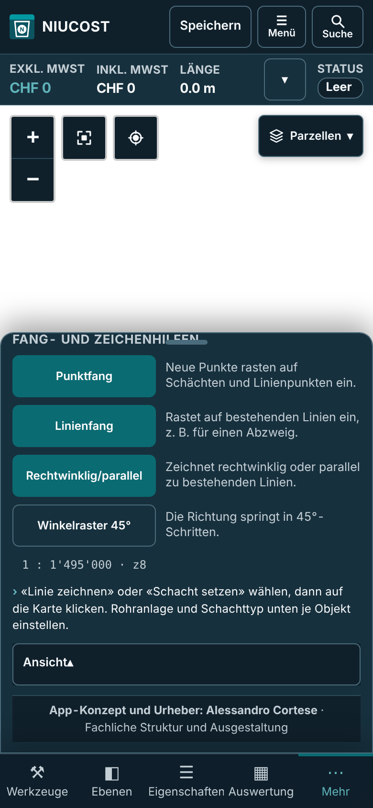 |

Test: `t140` (neu): 360/390 px ohne Seitenüberlauf und ohne sich überdeckende Bedienelemente (Rechtecke aller sichtbaren Knöpfe, Felder und Hinweise in Karte, «Mehr», «Werkzeuge», «Auswertung», mit und ohne Startkarte), Kennzahlen, Beschriftungen, Zeichenhilfen, Tooltip. `ui_qa` (360/390) grün.

## P8 – Export-Knöpfe ordnen

**Für die Benutzer:** Statt sieben gleichwertiger Knöpfe gibt es einen Hauptknopf «Drucken / PDF» und daneben zwei Menüs:
- «Exportieren ▾»: Excel exportieren, Projektbericht (Druck/PDF), Ausführlich drucken (alle Rechenwege), Kurzausdruck (1 Seite)
- «Datei ▾»: Sichern (JSON), Laden (JSON)

Eine Wahl schliesst das Menü. Es ist immer nur ein Menü offen, Esc und ein Klick daneben schliessen es (Fokus zurück auf den Menüknopf). In Layout A zeigt das Register «Ausgabe» der Multifunktionsleiste dieselben Gruppen «Drucken», «Exportieren», «Datei». Excel, Bericht und Sichern arbeiten aus dem Arbeitsplatz heraus, «Laden (JSON)» öffnet das geladene Projekt wieder in der Karte.

| | Desktop 1440 px | Handy 390 px |
|---|---|---|
| vorher | 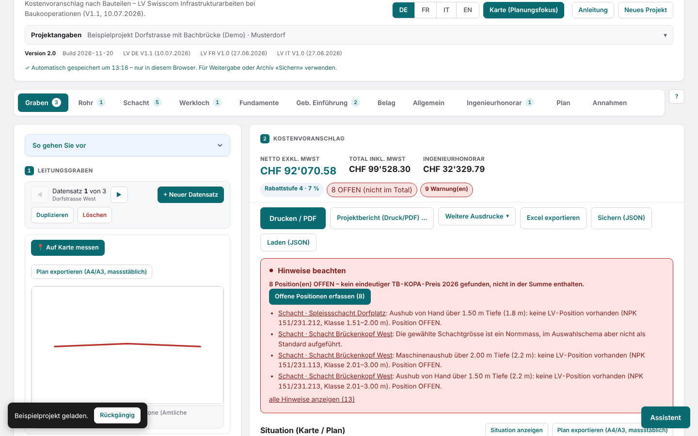 | 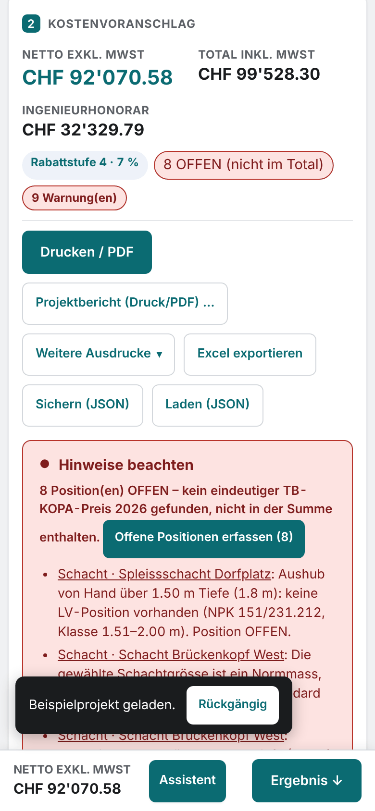 |
| nachher (Menü «Exportieren» offen) | 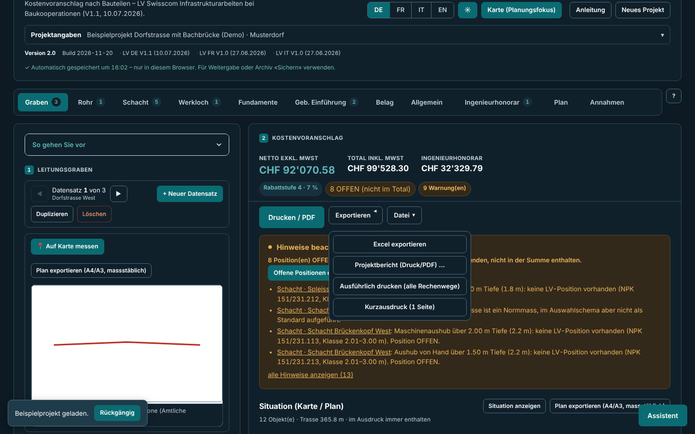 | 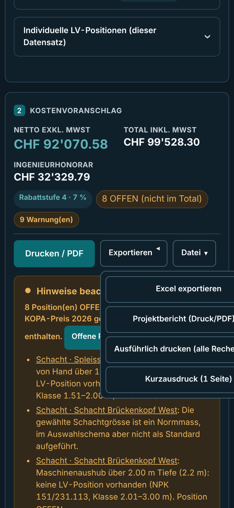 |
| nachher Layout A, Register «Ausgabe» | 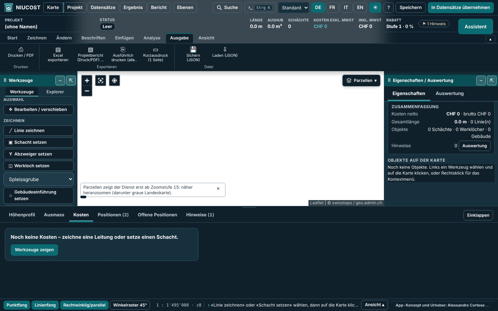 | |

Test: `t141` (neu). Angepasst: Tests öffnen zuerst das Menü «Exportieren»/«Datei» (`t58`, `t64`, `t66`, `t70`, `t73`, `t75`, `t122`, `t131`, `t133`, `ui_qa`).

Nachtrag P7: Mit Beispielwerten (sechsstellige Beträge) lag der Knopf ▾ auf 360/390 px über der Kennzahl «Länge». Die Kennzahlenleiste bricht jetzt um (Kennzahlen · ▾ · Status in eigener Zeile); `t140` prüft zusätzlich das Beispielprojekt.

## P11 – Explorer-Kontextmenü

**Für die Benutzer:** Ein Objekt im Explorer (Leitung, Schacht, Hauseinführung …) hat ein Kontextmenü mit «Auf Karte zeigen», «Eigenschaften», «Umbenennen», «Duplizieren» und «Löschen». Es öffnet sich mit Rechtsklick, mit der Kontextmenütaste bzw. Umschalt+F10 und neu auf dem Handy/Tablet mit **langem Druck (550 ms)**. Bewegt sich der Finger mehr als 8 px (Scrollen), öffnet sich nichts. «Löschen» fragt nicht mehr mit einem Bestätigungsdialog nach, sondern löscht sofort und zeigt die Meldung «… gelöscht» mit «Rückgängig»; «Rückgängig» stellt das Objekt mit Namen und Lage wieder her.

| | Desktop 1440 px | Handy 390 px |
|---|---|---|
| nachher (Menü offen) | 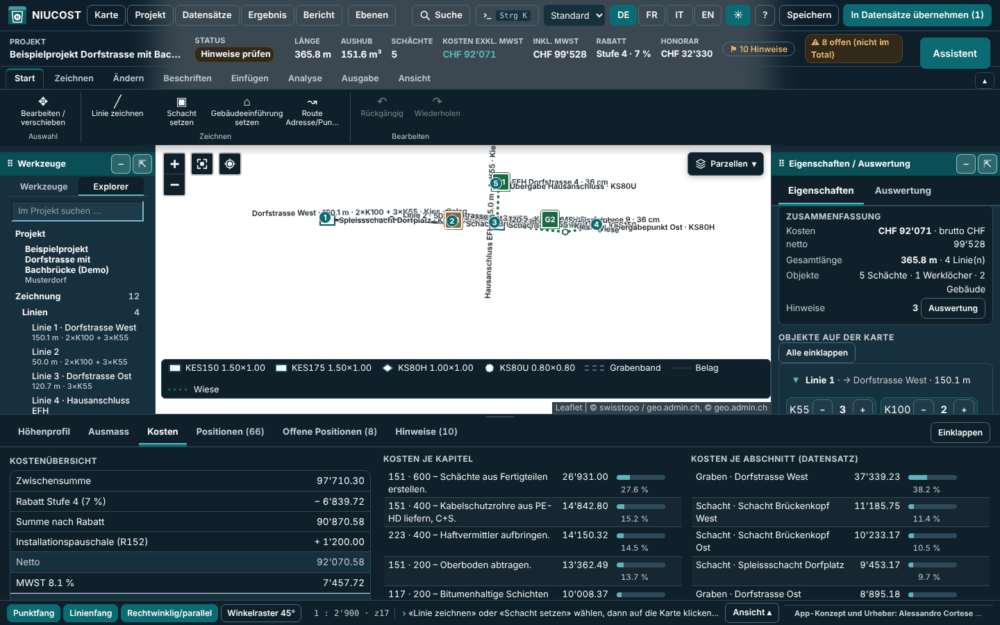 | 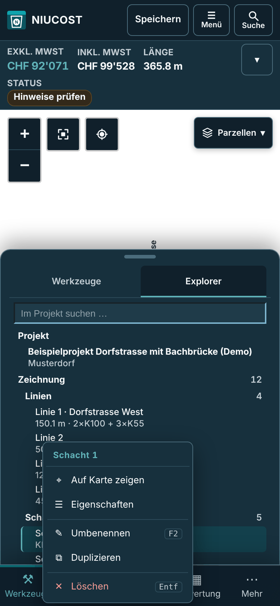 |

Das Menü selbst bestand schon (Rechtsklick); neu sind der lange Druck und das Löschen ohne `confirm()`. Kein Vorher-Bild, weil sich das Menü auf dem Handy bisher nicht öffnen liess.

Test: `t142` (neu): Rechtsklick, kurzer Druck öffnet nichts, langer Druck öffnet das Menü, Umbenennen, Duplizieren, Löschen ohne Dialog mit «Rückgängig». Angepasst: `t82` (Befehlsleiste ›_ jetzt im Blatt «Mehr»).
